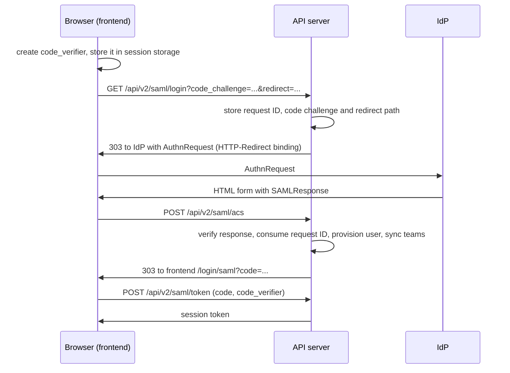

| Status   | Date       | Author(s)                                              |
|:---------|:-----------|:-------------------------------------------------------|
| Proposed | 2026-10-28 | [@stephan-wolf-ais](https://github.com/stephan-wolf-ais) |

## Context

Dependency-Track supports three ways for people to log in: managed users with a password, LDAP, and OpenID Connect (OIDC).
Many organizations run identity providers (IdPs) that speak SAML 2.0 only, or that their security teams want to use with
SAML. Examples are Active Directory Federation Services (AD FS), Shibboleth, and Entra ID setups that already exist for other
applications. Today these organizations cannot use single sign-on with Dependency-Track.

OIDC users get three features beyond the login itself. Accounts can be created on first login (user provisioning).
Team memberships can follow the groups that the IdP sends (team synchronization). Groups that the IdP sends can be created
automatically, so that administrators only have to map them to teams. SAML users need the same features.

SAML differs from OIDC in a way that matters for the architecture. With OIDC, the frontend runs the login flow and sends
the resulting tokens to the API server. With SAML, the IdP sends the response as an HTML form `POST` from the user's browser
to an endpoint of the service provider (SP), the assertion consumer service (ACS). The frontend is a static single page
application and cannot receive such a request. The API server has to.

SAML responses are signed XML documents. Verifying them correctly is hard. Well-known attacks move the signed element and
insert an unsigned one that the application reads instead (signature wrapping), or abuse XML features such as external
entities.

### Possible Solutions

#### A: OpenSAML 5

OpenSAML is the reference SAML library for Java.

* Pro: Complete and widely used, with protection against the known attacks built in.
* Con: Version 5 is only published to the Shibboleth Maven repository. The build forbids repositories other than Maven Central.
* Con: It brings many transitive dependencies, among them Guava, Velocity, Apache HttpClient and the Servlet API.

#### B: pac4j

[pac4j] is a security library that offers one interface for many login protocols, among them SAML 2.0 and OIDC.
It was suggested in the original feature request.

* Pro: Widely used, and covers more of SAML than Dependency-Track needs.
* Con: Its SAML module builds on OpenSAML, so it has the same repository problem as option A.
* Con: It brings its own concepts for clients, profiles and sessions, which would have to be integrated with the
  existing login of Dependency-Track.

#### C: OneLogin java-saml

* Pro: Published to Maven Central, and small.
* Con: The last release was in 2022. A security-sensitive library without maintenance is a risk.

#### D: Keycloak SAML core

* Pro: Published to Maven Central and maintained.
* Con: Built as a part of Keycloak, not as a library. It brings JAX-WS, SAAJ and a runtime implementation of them.

#### E: XML signature API of the JDK, with our own SAML checks

The JDK ships an implementation of XML signatures (JSR 105, module `java.xml.crypto`). It is based on Apache Santuario.

* Pro: No new dependency.
* Pro: We only need a small part of SAML: the HTTP-Redirect binding for requests and the HTTP-POST binding for responses.
* Con: We own security-sensitive code. It needs careful tests, including tests for signature wrapping.

## Decision

We will implement a SAML 2.0 service provider in `apiserver`, using option E.

### Login flow

The API server never puts a session token into a URL. It redirects with a one-time code instead. The code expires after
one minute and can be used once. The frontend exchanges it for a session token, together with a code verifier as in
PKCE ([RFC 7636]). This binds the login to the browser that started it. An attacker cannot log a victim into the attacker's
account by sending the victim a link with a code, or by making the victim's browser post a response for the attacker's
account. The binding needs no cookies, which would require `SameSite=None` because the IdP posts across sites.

Only logins started by Dependency-Track are accepted. The server stores the ID of each authentication request in the database,
and the response must refer to it with `InResponseTo`. The server deletes the request when the response arrives, so a
response cannot be replayed. This works across several API server nodes. Logins started by the IdP (IdP-initiated SSO)
are refused.

### Verification

The server verifies a response as follows. Any failure refuses the login without saying which check failed.

* The XML parser refuses document type declarations, so no entities are expanded.
* The response must have status `Success`, and must contain exactly one assertion, not encrypted.
  The document must not contain more than one assertion, and no two elements may share an `ID`.
* The response or the assertion must carry a signature. The server verifies every signature that is present on either.
  A signature must sit directly in the element that it signs, and must have exactly one reference, which points to that element.
  Only the enveloped signature and exclusive canonicalization transforms are allowed.
* The server verifies signatures with the certificates from the IdP metadata only. It ignores keys in the message.
  Secure validation of the JDK is on, which refuses weak algorithms such as SHA-1.
* The server reads data only from the verified assertion.
* Issuer, destination, recipient, audience and the time limits must match. Clock skew of up to 60 seconds is allowed.

### IdP configuration

The server reads the IdP's entity ID, single sign-on URL and signing certificates from its SAML metadata. Administrators
configure a metadata URL or a file in the deployment configuration. The server caches the metadata and fetches it again
after one hour. When fetching fails, it keeps using the cached metadata.

The server publishes its own SP metadata at `GET /api/v2/saml/metadata`, which administrators can upload to the IdP.

### Users, groups and teams

SAML users get the new user type `SAML`. The username comes from the subject `NameID`, or from an attribute if one is configured.
SAML groups are stored in their own table, separate from OIDC and LDAP groups, and mapped to teams the same way.
User provisioning, team synchronization, default teams and automatic creation of groups work as for OIDC,
and are configured separately.

New endpoints to manage SAML users, SAML groups and their mappings are part of REST API v2, under `/saml`.
Team memberships of SAML users use the existing endpoints that work for all user types.

### Out of scope

* Signed authentication requests, and encrypted assertions.
* Single logout.
* Verifying the signature of IdP metadata. The metadata is fetched over HTTPS from a URL that an administrator configured.
* More than one IdP.

## Consequences

Organizations with a SAML IdP can use single sign-on, with the same automation as OIDC.

We add no dependency, but we maintain code that verifies SAML responses. Changes to it need review with security in mind,
and the tests for known attacks must stay.

For the first time, the API server redirects browsers to the frontend. Administrators must configure the public URL
of the frontend for that, as a general setting that other features can use as well. They must also configure the
public URL of the assertion consumer service, because it is part of the configuration at the IdP.

Two small unlogged tables hold pending authentication requests and one-time codes. Losing them in a database crash
only aborts logins that are in progress. A scheduled task deletes expired rows.

[pac4j]: https://www.pac4j.org
[RFC 7636]: https://datatracker.ietf.org/doc/html/rfc7636
